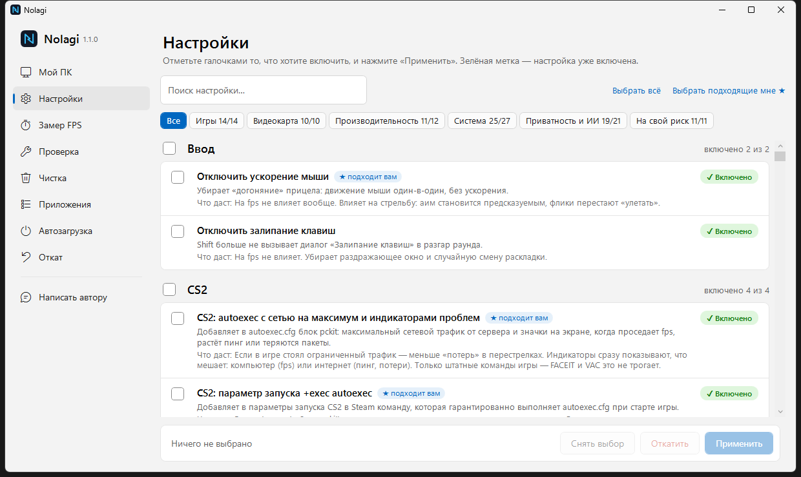
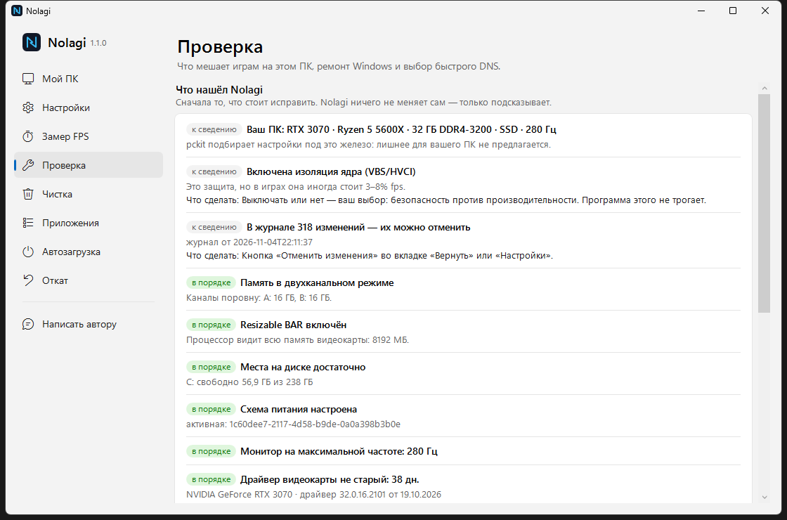

# Nolagi

Бесплатная программа для Windows 10/11, которая настраивает ПК для игр: CS2, Dota 2 и любых других. Nolagi смотрит, какое у вас железо, и сам отмечает настройки, которые подходят именно вашему ПК. Всё, что программа меняет, записывается в журнал и отменяется одной кнопкой.

**Безопасно для FACEIT и VAC.** Nolagi не трогает Защитник Windows, UAC, изоляцию ядра (VBS), загрузчик и не отключает обновления безопасности.

## Как установить

1. Откройте [последний выпуск](https://github.com/khamrabekoff/nolagi/releases/latest) и скачайте **Nolagi.exe**.
2. Запустите его. На вопрос Windows «Разрешить изменения?» нажмите **Да**: права администратора нужны, чтобы менять настройки системы.
3. Если появится «Windows защитила ваш компьютер», нажмите **Подробнее → Выполнить в любом случае**. У файла пока нет цифровой подписи.

При первом запуске Nolagi устанавливается сам: появляется в меню Пуск, на рабочем столе и в «Установленных приложениях», откуда его можно удалить. Новые версии программа предлагает сама при запуске. Запуск без установки: `Nolagi.exe /portable`.

## Что умеет

| Вкладка | Что там |
|---|---|
| **Мой ПК** | Процессор, видеокарта, память, диск, монитор, сеть, найдены ли CS2 и Dota 2. |
| **Настройки** | Около 100 настроек в разделах «Игры», «Видеокарта», «Производительность», «Система», «Приватность и ИИ», «На свой риск». У каждой — что она делает, какой даёт эффект и подходит ли вашему ПК. Перед применением создаётся точка восстановления Windows. |
| **Замер FPS** | Результат карты «CS2 FPS Benchmark»: средний FPS и 1% low, разница с прошлым замером. |
| **Проверка** | Что мешает играм: одна планка памяти, выключенный Resizable BAR, старый драйвер, мало места. Ремонт Windows (системные файлы, сброс сети) и выбор самого быстрого DNS. |
| **Чистка** | Временные файлы, кэши браузеров и шейдеров, старые драйверы: видно, сколько места освободится. |
| **Приложения** | Удаление ненужных встроенных приложений Windows. |
| **Автозагрузка** | Программы и задачи по расписанию, которые стартуют вместе с Windows, с подсказками, что можно выключить. |
| **Откат** | Вернуть одну настройку или всё сразу. |

Спорные твики собраны в разделе «На свой риск» и выключены, пока вы не отметите их сами. Популярные «ускорения», которые не работают (Nagle, HPET, «очистка памяти»), не включаются вообще: в разделе «Мифы» объяснено почему.

## Приватность

Статистика отправляется автору **только с вашего согласия**. Подробно о том, что и куда уходит, написано в [PRIVACY.md](PRIVACY.md).

## Для разработчика

- `app\src\` — окно программы (C# 5, WPF, .NET Framework 4.8), `app\bridge.ps1` — связь окна с движком.
- `engine\` — логика на PowerShell 5.1, `data\actions.json` — список настроек с шагами, проверкой и откатом.
- Сборка: `powershell -ExecutionPolicy Bypass -File app\build.ps1` → `dist\Nolagi.exe`. Компилятор `csc` уже есть в Windows, Visual Studio не нужна.
- Тесты: `powershell -NoProfile -File tests\<имя>.Tests.ps1`.
- Как предложить изменение или новую настройку — в [CONTRIBUTING.md](CONTRIBUTING.md). Об уязвимостях — в [SECURITY.md](SECURITY.md).

Nolagi вырос из **pckit by odilbek** — прежней версии в одном файле `.cmd`. Её код лежит в [`legacy/`](legacy), старые выпуски — в [Releases](https://github.com/khamrabekoff/nolagi/releases).

## Лицензия

[GPL-3.0](LICENSE). Программу можно свободно использовать, изучать и менять. Если вы распространяете изменённую версию, её код тоже должен быть открыт под GPL-3.0.

---

## English

**Nolagi** is a free Windows 10/11 tuning tool for gamers (CS2, Dota 2 and others). It reads your hardware, recommends the settings that fit your PC, and records every change in an undo journal, so anything can be reverted with one click. It never touches Windows Defender, UAC, VBS, the boot loader or security updates, so it is safe to use with FACEIT and VAC.

Features: about 100 documented tweaks in sections (games, GPU, performance, system, privacy and AI, at your own risk), NVIDIA per-game driver profiles, a CS2 FPS benchmark, a PC health check (RAM channels, Resizable BAR, driver age), Windows repair (DISM/SFC, network reset), a DNS benchmark, cleanup, built-in app removal and a startup manager. The interface is in Russian.

Download **Nolagi.exe** from the [latest release](https://github.com/khamrabekoff/nolagi/releases/latest). Anonymous statistics are sent only with your consent, see [PRIVACY.md](PRIVACY.md). Licensed under [GPL-3.0](LICENSE).
